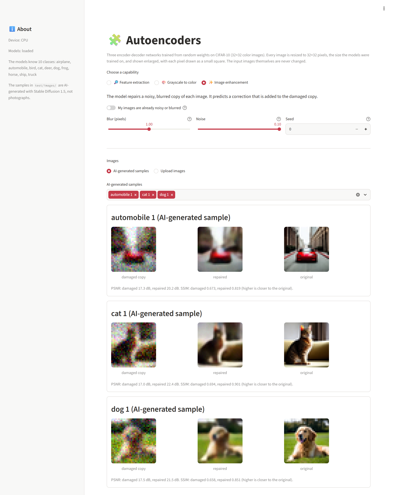

# 🧩 How the Autoencoders Work

This page explains the three models in `autoencoder.ipynb`: how the encoder and decoder work, how each model is trained, and what each measurement means. For setup steps, see the [README](README.md).

## 🔁 1. Encoder and decoder

### The idea

An autoencoder has two halves. The encoder turns an image into a short list of numbers, and the decoder turns that list back into an image. Training compares the decoder's image with a target image and adjusts both halves to bring them closer.

The dataset images are never changed. Every image the models produce, whether colorized or repaired, is a new image computed from a copy in memory, and the figures always show it next to the untouched original.

### The encoder

The encoder works in steps. Each step halves the width and height of the image and increases the number of channels, the separate values stored for each position:

| Step | Size | Channels | Numbers in total |
|---|---|---|---|
| Input image | 32×32 | 3 (red, green, blue) | 3,072 |
| After step 1 | 16×16 | 64 | 16,384 |
| After step 2 | 8×8 | 128 | 8,192 |
| After step 3 | 4×4 | 256 | 4,096 |
| Bottleneck | none | none | 128 |

Each step is made of convolutional layers: small 3×3 filters that slide over the image and respond to patterns such as edges, color changes and textures. The early steps respond to simple patterns at specific positions, and the later steps combine them into larger shapes over the whole image. The last layer turns the 4,096 numbers into 128, the bottleneck.

### The decoder

The decoder mirrors the encoder: it turns the 128 numbers back into 4×4×256 values, then doubles the size at each step (4 → 8 → 16 → 32) while reducing the channels, ending with 3 color channels between 0 and 1.

The decoder never sees the original image and does not know what it looks like. Its only input is the 128 numbers, from which it tries to redraw the image, so whatever those numbers do not hold is missing from the drawing. The original image stays unchanged.

### Why the drawings are not shown

In the feature-extraction model, the decoder serves training only. 128 numbers are about 4% of the 3,072 in an image, so the encoder has to choose what to keep, and training rewards it for keeping what lets the decoder redraw the image. Training compares the drawing with the original pixel by pixel, using mean squared error. When the decoder is unsure where an edge goes, a soft average costs less than a sharp edge in the wrong place, so its drawings keep the main colors and layout but not the edges and fine detail. They show what the 128 numbers hold about appearance; what they hold about content is measured by recognition and search instead, so the drawings are not part of the results.

## 🔎 2. Feature extraction

### The model

A convolutional autoencoder with the steps above (2.9 million parameters). Each encoder step has two convolutional layers: one that halves the size and one that refines the result at the new size.

### Why it also learns the labels

Redrawing the image is the only goal of a plain autoencoder, and it mostly teaches color and layout: a brown bird on grass and a frog on grass end up with similar numbers. In a full run of an earlier version, trained on redrawing alone with one convolutional layer per step and no random flips or shifts, a linear classifier on the encoder's 128 numbers scored 37.7% on the test images, barely above the 37.3% of an encoder with random weights.

The model therefore has a small classifier that predicts the class (airplane, automobile, cat and so on) from the same 128 numbers, and training adds its error to the redrawing error:

```
loss = redrawing error + 0.1 × classification error
```

The weight of 0.1 was chosen by comparing 0, 0.01, 0.1 and 1 in a short test: higher weights grouped images by class better and redrew them less sharply, and 0.1 gave most of the grouping for a moderate loss of sharpness.

Each training image is also flipped left to right at random and shifted by up to 4 pixels, so the model learns what the image shows rather than exact pixel positions.

### The measurements

| Measurement | What it shows | Result |
|---|---|---|
| Recognition | How often the class predicted from the 128 numbers is right, overall and for each class | 89.4% |
| Linear classifier | A new linear classifier fitted on 10,000 training images: raw pixels / untrained encoder / trained encoder | 28.1% / 36.5% / 88.8% |
| Same-class matches | For each test image, how many of the 5 test images with the closest features share its class (chance is about 10%) | 85.9% |
| Decoder drawings | How close the decoder's drawings are to the originals (PSNR, see the glossary); used only for training | 21.0 dB |

The notebook also draws a map of 2,000 test images with t-SNE, which places images with similar features near each other in two dimensions, and a grid with the first automobile, ship, cat and dog in the test set, each followed by its five closest matches and labelled with its class. Each grid row searches the test images labelled with the class the model recognizes in the query, among six classes (airplane, automobile, ship, truck, cat and dog), and its label shows both the query's true class and the recognized one. A misrecognized query therefore shows matches of the wrong class, visibly. The same-class share above uses no such filter: it ranks all 10,000 test images by their features alone.

Recognition is lowest for cats (78%) and dogs (82%), which CIFAR-10 shows in similar poses and settings, and highest for automobiles (96%) and ships (95%).

After training, the notebook also prints the feature vector of each of the eight CIFAR-10 test images shown in the figures (the first 8 of its 128 numbers) with the class recognized from them. The numbers are learned, so no single number has a fixed meaning such as "furry" or "metallic"; the classifier and the search use all 128 together. "Closest" means the highest cosine similarity: the angle between two lists of 128 numbers, ignoring their size.

## 🎨 3. Grayscale to color

### The Lab color space

RGB mixes brightness and color in all three channels. The Lab color space separates them: L is brightness, and a (green to red) and b (blue to yellow) are color. A grayscale image is exactly the L channel, so the model receives L and predicts a and b. The output combines the model's a and b with the original L, so the brightness and fine detail of the output always match the original.

### The U-Net

A U-Net is an encoder-decoder with skip connections: at each size, the decoder receives the encoder's values from the same size as well as its own. Detail such as edges travels across directly, while the narrow middle (4×4) gives each position a view of the whole image, which helps decide, for example, that a large blue area at the top is likely sky.

The same U-Net design is used for enhancement. It has 4.3 million parameters, with 48, 96, 192 and 384 channels at the four sizes. Strictly, it is not a classic autoencoder, because its output differs from its input and the skip connections let detail bypass the middle, but it keeps the encoder-decoder shape.

### Training

- The output passes through tanh to keep a and b between -1 and 1, and the error is the smooth L1 loss, which is less sensitive to large differences than squared error.
- The last layer starts at zero, so before training the model predicts no color and outputs the grayscale image itself. Training then adds color where it learns to.
- The color model trains for 30 epochs, the feature model for 40 and the enhancement model for 15.

### Why the colors are muted

Colorization has no single right answer: a car could be red or blue. When several colors are equally likely, an average error is smallest for a color in between, which is often grayish. The notebook measures this as color strength, the average distance of a and b from gray, compared with the true images.

| Measurement | Result |
|---|---|
| PSNR: grayscale input against true colors | 24.8 dB |
| PSNR: colorized against true colors | 24.6 dB |
| Color strength: true images | 14.7 |
| Color strength: colorized | 10.4 |

PSNR counts a plausible but wrong color as an error: a white car colored yellow scores worse than the same car left gray. This is why the colorized images score slightly below the grayscale input while adding plausible colors, such as blue water and sky, and green and brown grass. Color strength measures how vivid the colors are, whether or not they match.

An earlier run with 15 epochs scored 25.1 dB with a color strength of 10.0. With 30 epochs the colors are stronger, the PSNR is 0.5 dB lower, and the training loss is about half (0.0017 against 0.0035), a sign that the model starts to fit its training images more closely than new ones. The notebook keeps 30 epochs for the more vivid colors.

## ✨ 4. Image enhancement

### The damage

During training, each image is copied and damaged with a random amount of blur (a Gaussian blur of 0.5 to 1.5 pixels) and random noise (a standard deviation of up to 0.1, with pixel values from 0 to 1). The original image is the target the model learns to recover. The test images get the same kinds of damage, generated from a fixed seed so every run is measured on identical damaged copies.

### The model

The same U-Net design as the color model, used as a denoising autoencoder: it learns to recover a clean image from a damaged one. It predicts a correction that is added to the damaged copy, which is easier to learn than drawing the whole image, since most of each image is already right. The last layer starts at zero, so before training the model returns the damaged copy unchanged.

| Measurement | Damaged copy | Repaired |
|---|---|---|
| PSNR | 23.0 dB | 28.1 dB |
| SSIM | 0.724 | 0.901 |

PSNR is averaged over all 10,000 test images, and SSIM over the first 1,000.

## 🚀 5. Training in Colab

### The shared training loop

All three models use the same loop:

- **Adam** optimizer, with a one-cycle learning rate that rises for the first part of training and then falls, which speeds up early training and settles the model at the end.
- **Mixed precision** on the GPU: most calculations run in 16-bit numbers, which a T4 handles faster.
- The training and test images are kept on the GPU as 8-bit pixels (about 180 MB), so no time is spent loading images during training.

### The settings

| Setting | Default | What it does |
|---|---|---|
| `QUICK_CHECK` | off | 1 epoch on 2,000 images, to check every cell in a few minutes |
| `EPOCHS` | 15 | Passes over the 50,000 training images for the enhancement model |
| `FEATURE_EPOCHS` | 40 | Passes for the feature-extraction model, about 4 seconds each on a T4 |
| `COLOR_EPOCHS` | 30 | Passes for the color model |
| `LATENT_SIZE` | 128 | The size of the feature-extraction bottleneck |
| `NOISE_LEVEL` | 0.1 | The strongest noise added for enhancement |
| `SEED` | 1337 | Makes the data order and the test damage repeatable |
| `SAVE_TO_DRIVE` | on | Copies the trained models to Google Drive |

⏱️ The full run took about 14 minutes on a T4: 2.5 minutes for the feature model, 6 for the color model, 4 for the enhancement model, and the rest for loading data and measuring.

## 🖥️ 6. The app

`app.py` loads the three trained models from `weights/autoencoders.pt`, using the same model code as the notebook (`autoencoder_models.py`). The page offers the three capabilities as options; for the chosen one, it processes every selected AI-generated sample or uploaded image and shows each result in its own panel. Any image, a sample or an upload, is cropped to a centered square and resized to 32×32 pixels, because the models only work at the size they were trained on. The input image itself is never changed: every result is computed from a copy.

- **🔎 Feature extraction:** the classifier gives its three most likely classes from the image's 128 numbers, which the app also lists. Each answer is averaged over 10 views of the image: the image and its mirror image, and four shifts of 2 pixels of each. This test-time averaging raised recognition from 89.4% to 91.0% on the CIFAR-10 test images, and from 14 to 16 of the 18 AI-generated samples, measured with the same trained weights. The model always chooses among its 10 CIFAR-10 classes, even for an image that shows none of them. The five closest samples are the samples of the recognized class, by file name, ranked by cosine similarity between their 128 numbers and the chosen image's; if no sample has that class, all samples are searched.
- **🎨 Grayscale to color:** the model receives only the brightness. For a color image, the app also shows the true colors with the PSNR and color strength used in the notebook. An image whose three color channels are equal is treated as grayscale and shown without a comparison.
- **✨ Image enhancement:** the app damages a copy of each image with the notebook's method, a blur followed by random noise, and then repairs it, showing the damaged copy, the repair and the original side by side. Four controls set the damage:

  | Control | What it does |
  |---|---|
  | *My images are already noisy or blurred* | Off: the app damages a copy, repairs it and measures the repair against the original. On: it repairs each image as it is, with no damage added; there is no clean original to compare with, so no scores are shown. |
  | *Blur (pixels)* | The strength of the Gaussian blur, from 0.5 to 1.5 pixels. Higher values spread each pixel further into its neighbors and soften edges more. |
  | *Noise* | The strength of the random noise, as a standard deviation from 0 to 0.10 on a brightness scale of 0 to 1. At 0.10, a typical pixel changes by about a tenth of the full brightness range. |
  | *Seed* | Chooses the random noise pattern. The same seed and settings give the same damaged copy; another seed gives a new pattern of the same strength. |

  The blur and noise sliders stop at the training range, because the model was not trained on stronger damage and its repairs outside that range are not meaningful.

  

  *The app's image enhancement view at its default settings (blur 1.0 pixel, noise 0.10, seed 0), running on a laptop CPU. The samples are AI-generated; the repaired images and the scores are the model's actual output.*

The sample images in `test/images/` are AI-generated, not photographs: they were created with Stable Diffusion 1.5 at 512×512 pixels, from one plain prompt per image such as "a photo of a red car parked on a city street", and reduced to 32×32 pixels.

## 📖 Glossary

- **Epoch:** one pass over all training images.
- **Bottleneck:** the narrowest point between encoder and decoder, here the 128 numbers.
- **Feature vector (embedding):** the 128 numbers the encoder produces for one image. Each is a continuous value, and together they describe the whole image. They are not tokens: a token is one discrete unit from a fixed vocabulary, such as a word piece in a language model, and a model processes a sequence of them.
- **PSNR (peak signal-to-noise ratio):** a measure of how close an image is to the original, in decibels. Higher is closer; each 3 dB means roughly half the squared error.
- **SSIM (structural similarity):** a measure from 0 to 1 of how well structure and edges match the original. Higher is better.
- **Skip connection:** a direct link from an encoder step to the decoder step of the same size.
- **Linear classifier:** a classifier that can only separate classes with straight boundaries, so it scores well only if the features already separate them.

## 📚 Credit and sources

The dataset and methods used here are the work of their authors, with thanks:

- **Dataset:** [CIFAR-10](https://www.cs.toronto.edu/~kriz/cifar.html) by Alex Krizhevsky, Vinod Nair and Geoffrey Hinton, described in *Learning Multiple Layers of Features from Tiny Images* (Krizhevsky, 2009), downloaded from its [Hugging Face copy](https://huggingface.co/datasets/uoft-cs/cifar10)
- **Methods:** supervised autoencoders (Le, Patterson and White, 2018), test-time averaging over flipped and shifted views (as in Krizhevsky, Sutskever and Hinton, 2012), U-Net (Ronneberger et al., 2015), denoising autoencoders (Vincent et al., 2008), t-SNE (van der Maaten and Hinton, 2008), SSIM (Wang et al., 2004) and the one-cycle learning rate (Smith, 2018)
- **Test images:** AI-generated with [Stable Diffusion 1.5](https://huggingface.co/stable-diffusion-v1-5/stable-diffusion-v1-5) by CompVis, Stability AI and Runway
- **Libraries:** PyTorch, scikit-learn, scikit-image, matplotlib and Streamlit
