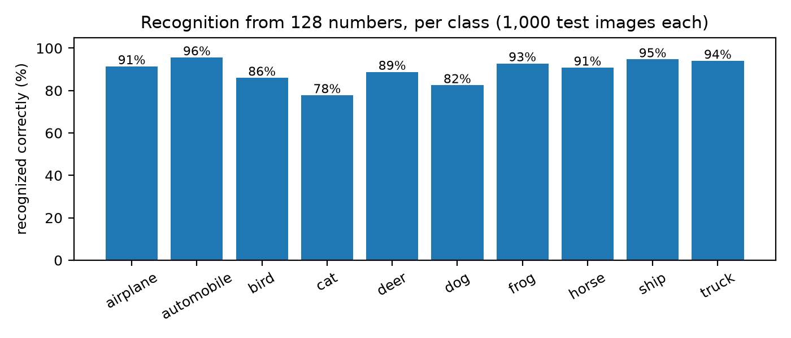
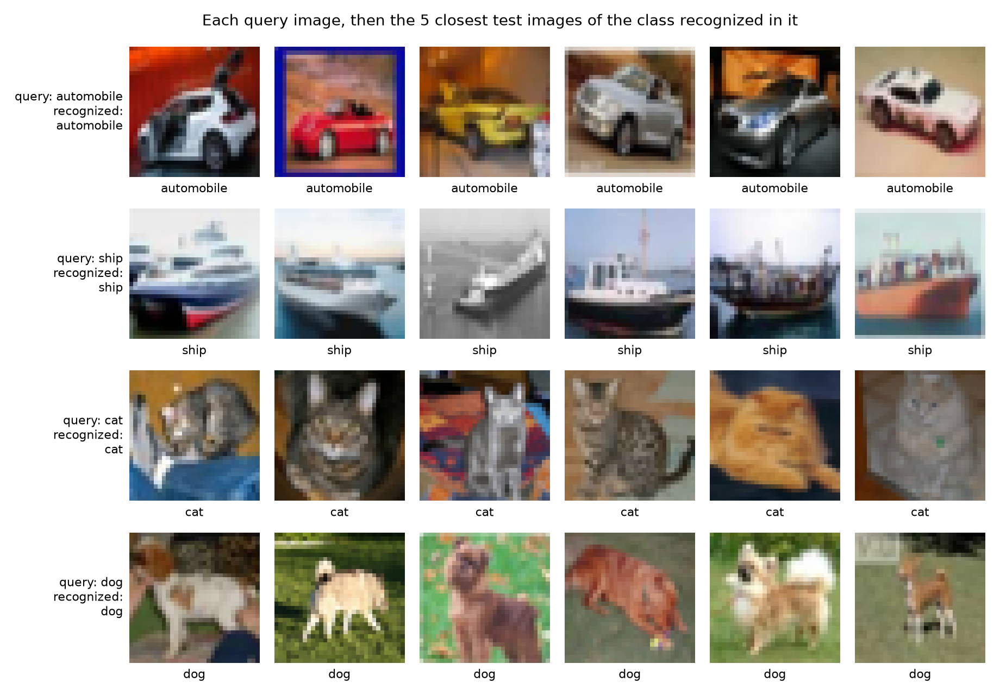
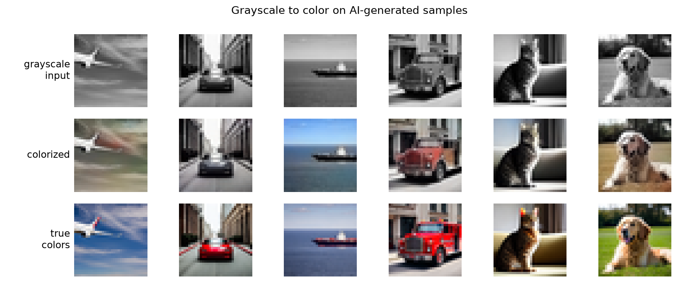
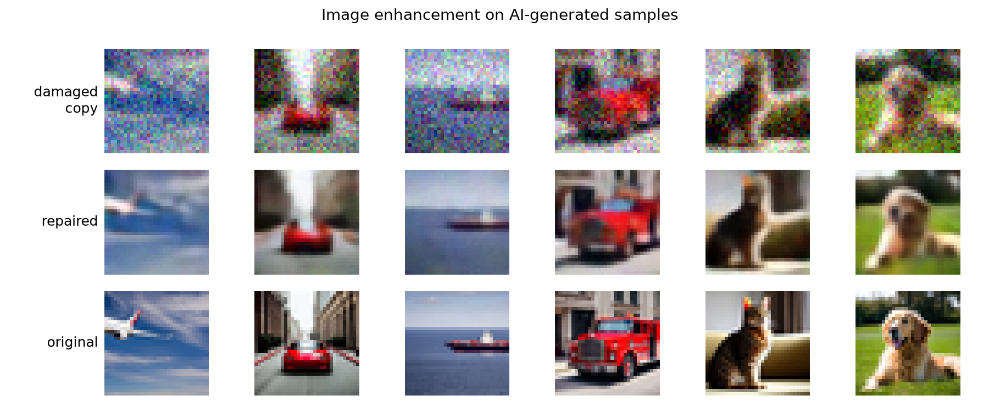

# 🧩 Autoencoders: Feature Extraction, Colorization and Enhancement

Three encoder-decoder networks trained from random weights on CIFAR-10 in Google Colab on a T4 GPU: one describes each image with 128 numbers, used to recognize objects and find similar images, one adds color to grayscale images, and one removes noise and blur.

| Task | Input → output | Type | Result on 10,000 unseen test images |
|---|---|---|---|
| 🔎 Feature extraction | image → 128 numbers → class and similar images | Convolutional autoencoder with a label signal | Class recognized for 89.4% of images; 85.9% of the 5 closest matches have the same class |
| 🎨 Grayscale to color | brightness → color | U-Net (encoder-decoder with skip connections) | Color strength 10.4, against 14.7 for the true images; PSNR 24.6 dB, against 24.8 dB for the grayscale input |
| ✨ Image enhancement | noisy, blurred copy → repaired image | Denoising autoencoder built on a U-Net | PSNR 23.0 → 28.1 dB, SSIM 0.724 → 0.901 |

> 🌱 NOTE: CIFAR-10 images are 32×32 pixels. The figures below enlarge them without smoothing, so each visible square is one original pixel; the notebook's own figures smooth them and look softer. All damage and coloring happens to copies in memory: the dataset images themselves are never changed.

> ☁️ Google Colab provides the GPU. Google Drive, if connected, keeps a copy of the trained models.

> 📘 [DETAILS.md](DETAILS.md) explains each model, the training and the measurements step by step.

## 🖼️ Visual results

**Feature extraction** on the 10,000 CIFAR-10 test images, which were not used in training: how often each class is recognized from the 128 extracted numbers, and four test images with their closest matches.



<p align="center"></p>

📷 Source: [CIFAR-10](https://www.cs.toronto.edu/~kriz/cifar.html) test set, shown at the original 32×32 resolution.

**Grayscale to color and image enhancement** on AI-generated sample images from `test/images/`, which are not part of CIFAR-10.





> 🤖 AI-GENERATED INPUTS: In the color and enhancement figures, only the sample images given to the models are AI-generated: the "true colors" and "original" rows, created with Stable Diffusion 1.5 and reduced to 32×32 pixels. They are not photographs. The "grayscale input" and "damaged copy" rows are made from them by this project's code, and the "colorized" and "repaired" rows are the output of this project's models. The feature-extraction figures show CIFAR-10 test photos.

## 📁 Files

| File | What it is |
|---|---|
| 📓&nbsp;`autoencoder.ipynb` | The Colab notebook: data, the three models, training and measurements, with the outputs of a T4 run |
| 📘&nbsp;`DETAILS.md` | How the encoder-decoder models, the training, the measurements and the app work |
| 🖥️&nbsp;`app.py` | A Streamlit app to try the three trained models on your own computer |
| 🧩&nbsp;`autoencoder_models.py` | The notebook's three models and image helpers, used by the app |
| 📦&nbsp;`requirements.txt` | The libraries the app needs |
| 🔒&nbsp;`.streamlit/config.toml` | Keeps the app reachable only from your own computer |
| 🧪&nbsp;`test/` | AI-generated 32×32 sample images for the app |
| 🖼️&nbsp;`assets/` | The images in Visual results above: the notebook's feature-extraction results, redrawn from the trained model without smoothing, color and enhancement results on the AI-generated samples, and a screenshot of the app for DETAILS.md |

The dataset is downloaded at run time. Trained weights are saved to Colab and Google Drive, not to this repository.

## 🔁 Encoder and decoder

All three models have two halves:

- The **encoder** shrinks the image step by step (32×32 → 16×16 → 8×8 → 4×4 pixels), keeping more channels at each step, so it trades detail about where things are for a description of what is there.
- The **decoder** reverses this, growing the description back into a full 32×32 image.

In the feature-extraction model, the only link between the two halves is 128 numbers, about 4% of the 3,072 numbers in an image. These 128 numbers are the features, together called a feature vector or embedding: they are used to recognize the object and to find similar images. They are continuous values describing the whole image, not tokens, which are discrete units from a fixed vocabulary, as in language models. The decoder serves training only. It never sees the original image and does not know what it looks like: its only input is the 128 numbers, from which it tries to redraw the image. Having to make that drawing possible forces the 128 numbers to hold the essentials of the image. The original image is not changed in any way.

The U-Net used for colorization and enhancement adds skip connections, which pass the detail from each encoder step directly to the matching decoder step. The decoder can then keep sharp edges, which colorization and enhancement need.

## 🚀 Run it

1. 📓 Open [Google Colab](https://colab.research.google.com), choose *File → Upload notebook* and pick `autoencoder.ipynb`.
2. ⚙️ Choose *Runtime → Change runtime type → T4 GPU*.
3. ▶️ Choose *Runtime → Run all*. Select `QUICK_CHECK` in the Settings cell first for a test of every cell in a few minutes, with poor results.

⏱️ The full run took about 14 minutes on a T4 (40 epochs for the feature model, 30 for the color model, 15 for enhancement).

## 🖥️ Use the app

The app runs the three trained models on your own computer, on a CPU or a GPU. Choose one of the three capabilities, then pick AI-generated sample images from `test/images/` or upload your own, one or several at a time; every image is cropped to a square and resized to 32×32 pixels, and each gets its own result panel.

| Capability | What it shows for each image |
|---|---|
| 🔎 Feature extraction | The three most likely classes, the 128 extracted numbers, and the five samples of the recognized class with the closest features |
| 🎨 Grayscale to color | The grayscale input, the colorized result and, for a color image, the true colors |
| ✨ Image enhancement | A damaged copy (blur and noise set with sliders), the repaired image and the original, or the repair of an image that is already damaged |

1. 📥 Get the code and install the libraries:
   ```
   git clone https://github.com/laurelthejas/autoencoders-recognize-colorize-enhance.git
   cd autoencoders-recognize-colorize-enhance
   python -m venv .venv
   .venv\Scripts\activate          (macOS or Linux: source .venv/bin/activate)
   pip install -r requirements.txt
   ```
2. 💾 Download `autoencoders.pt` from `MyDrive/autoencoder/` in Google Drive, created by the notebook, and save it in the repository as `weights/autoencoders.pt`. The `weights/` folder is ignored by git.
3. ▶️ Run `streamlit run app.py` and open http://127.0.0.1:8503.

⏱️ On a 6-thread laptop CPU, all three tasks together took about 33 milliseconds per image, including recognition averaged over 10 views.

## 🧪 Test samples

| Path | What it is |
|---|---|
| `test/images/` | 18 AI-generated 32×32 images: 3 each of airplanes, automobiles, ships, trucks, cats and dogs |

> 🤖 AI-GENERATED: The images in `test/images/` were created with Stable Diffusion 1.5 and reduced to 32×32 pixels. They are not photographs and do not show real animals, vehicles or places.

🔎 With the trained models, the app recognized 16 of the 18 AI-generated samples, averaging each answer over 10 flipped and shifted views of the image. It misread the cat lying on a rug as an automobile and the border collie as a horse. With a single view, as in the notebook, it recognized 14 of 18. The enhancement improved all 18 damaged copies. These images differ in style from the CIFAR-10 photos the models learned from, which partly explains the lower recognition rate than on the test images.

## 📊 Results

Measured on the 10,000 CIFAR-10 test images, none of which are used in training:

| Measurement | Result |
|---|---|
| 🔎 Class recognized from the 128 numbers | 89.4%, or 91.0% averaged over 10 flipped and shifted views as in the app (chance: 10%) |
| 🔎 Linear classifier on raw pixels / untrained encoder / trained encoder | 28.1% / 36.5% / 88.8% |
| 🔎 Share of the 5 closest matches with the same class | 85.9% (chance: about 10%) |
| 🎨 PSNR: grayscale input / colorized | 24.8 / 24.6 dB |
| 🎨 Color strength: true images / colorized | 14.7 / 10.4 |
| ✨ PSNR: damaged copy / repaired | 23.0 / 28.1 dB |
| ✨ SSIM: damaged copy / repaired | 0.724 / 0.901 |

PSNR and SSIM measure closeness to the original image; higher is closer. [DETAILS.md](DETAILS.md) explains each measurement.

## 📝 Notes

- 🏷️ The feature-extraction model learns from the class labels as well as from the decoder's redrawing. An earlier version, trained on redrawing alone (with a shallower encoder and no random flips or shifts), grouped images by color and layout more than content: a linear classifier on its features scored 37.7%, against 37.3% for an untrained encoder.
- 🎨 Colorization has no single right answer, since a car could be red or blue. A model trained on average error tends toward safe, muted colors, which the notebook measures as color strength. PSNR counts a plausible but wrong color, such as a white car colored yellow, as an error, so the colorized images score slightly below the grayscale input while adding plausible colors.
- 🔍 All results are measured on the 10,000 CIFAR-10 test images, none of which are used in training.

## ⚖️ License

MIT: see [LICENSE](LICENSE). [CIFAR-10](https://www.cs.toronto.edu/~kriz/cifar.html), by Alex Krizhevsky, Vinod Nair and Geoffrey Hinton (Krizhevsky, 2009), is downloaded at run time from its [Hugging Face copy](https://huggingface.co/datasets/uoft-cs/cifar10) and is not stored in this repository; the notebook's figures and two images in Visual results show some of its 32×32 test photos, which remain the work of their original authors. The AI-generated test images, also used in Visual results, were created with [Stable Diffusion 1.5](https://huggingface.co/stable-diffusion-v1-5/stable-diffusion-v1-5) (CreativeML OpenRAIL-M). PyTorch, scikit-learn, scikit-image, matplotlib and Streamlit keep their own licenses.

## 📚 References

- Alex Krizhevsky. *Learning Multiple Layers of Features from Tiny Images.* Technical report, University of Toronto, 2009. The report describing CIFAR-10, created by Alex Krizhevsky, Vinod Nair and Geoffrey Hinton.
- Lei Le, Andrew Patterson and Martha White. *Supervised Autoencoders: Improving Generalization Performance with Unsupervised Regularizers.* NeurIPS 2018. The method behind the feature extraction: an autoencoder trained to rebuild images and predict their class together.

## 🔗 Related projects

- [🎨 Diffusion Models: Image Generation and Captioning](https://github.com/laurelthejas/diffusion-models-image-generation-and-captioning): fine-tunes Stable Diffusion for text-to-image and image-to-image, and trains a small text-to-image diffusion model from scratch on Fashion-MNIST.
- [📖🖋️ C-Caption Transformer](https://github.com/laurelthejas/c-caption-transformer): a small transformer that learns from scratch to write and explain simple C programs.
